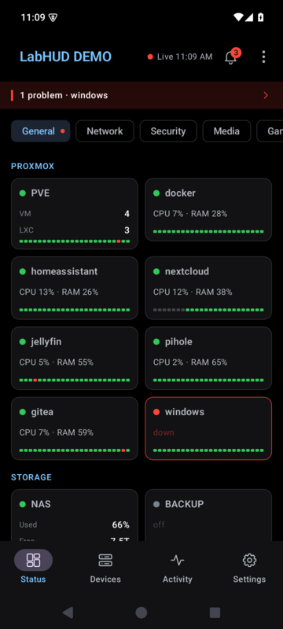
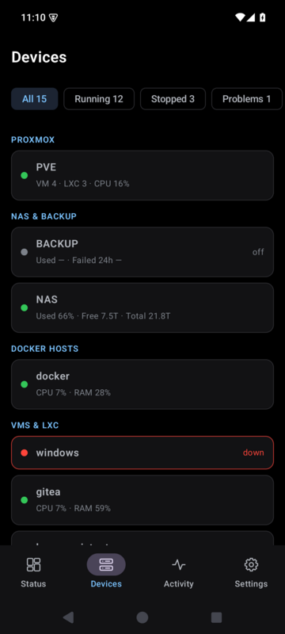
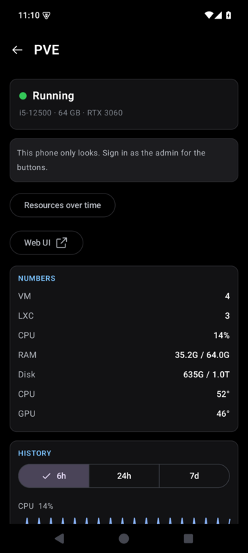

# LabHUD for Android

Your [labhud](https://github.com/Mithrandler/labhud) on your phone: what is red right now, every
card with its numbers, charts and panel, the day's timeline, the action buttons, and the whole
wall page when you want it. Native (Kotlin, Jetpack Compose, Material 3), small, and quiet on the
battery: it talks to your labhud only while it is open.

| | | |
|---|---|---|
|  |  |  |

- **Pairs with a QR code.** On the display: ⚙ > Phones > Pair a phone; or on the server
  `labhud phone pair`. Each phone gets a token of its own and only looks, until you **sign in as
  the admin** (Settings > Account): then the buttons work, after the wall's PIN or your fingerprint.
- **Status**: the wall's pages as chips, the cards in a grid with their numbers and 24 hours of
  uptime, a bell with the alerts and what is red, the game servers as a page of their own.
- **Devices** (hosts and guests, filtered by running, stopped, problems) and **Activity** (the
  timeline and the notifications).
- **A card's screen**: its numbers and charts, its panel, its buttons, and on a Docker host its
  containers with Update and their logs.
- **Server management** for the admin: phones, agents, where the news goes.
- **A lock if you want one**: none, the phone's PIN, or a fingerprint, asked when it opens and
  again after 5 minutes in the background.
- **A home screen widget**: all good, or what is red.
- **Wall mode**: the wall page full screen and kept on, for an old phone or tablet. It can be the
  home screen app, so it comes back after a reboot.
- **Notifications**: instant through [UnifiedPush](https://unifiedpush.org) with the ntfy app
  (labhud only knocks; the app reads the news itself, so the text never leaves your network), or
  through ntfy alone as before (`LABHUD_NOTIFY_CLICK=app` opens the app on the card).
- **Several servers**, one shown at a time.
- No Google services, no analytics, no backups of your tokens.

## Install

Download the APK from [Releases](../../releases) and open it on the phone (allow installing from
your browser once). [Obtainium](https://github.com/ImranR98/Obtainium) can keep it updated from the
same page. Android 10 or newer.

You need **labhud 0.1.0** or newer with `LABHUD_DATA` set (the paired phones are kept there). The
phone reaches labhud the way your browser does: on your home network, or from outside through a
VPN (WireGuard, Tailscale). Do not open labhud's port to the internet for it.

## Build

```sh
./gradlew assembleDebug          # app/build/outputs/apk/debug/
./gradlew testDebugUnitTest
```

JDK 17+ and the Android SDK (`local.properties`: `sdk.dir=...`). A release build is signed when
`keystore.properties` (storeFile, storePassword, keyAlias, keyPassword) or the `LABHUD_KEYSTORE*`
variables are there; CI does it for a `v*` tag.

The API it uses is [labhud's docs/app-api.md](https://github.com/Mithrandler/labhud/blob/main/docs/app-api.md).

## License

[MIT](LICENSE)
